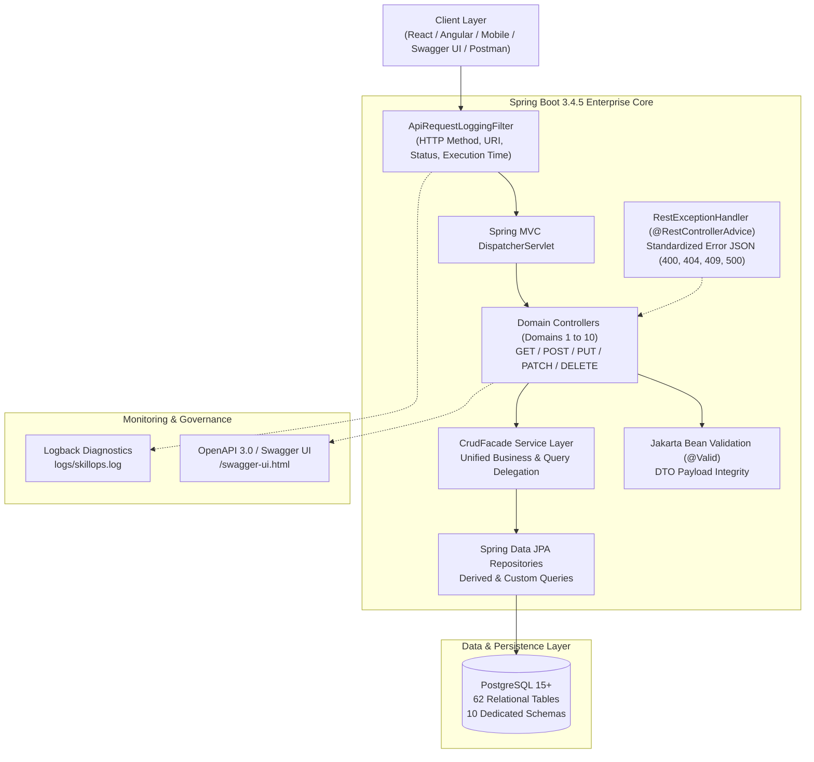
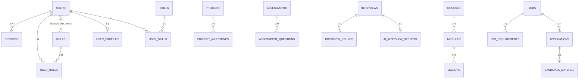

# SkillOps: AI-Powered Workforce Development & Hiring Operating System

<div align="center">

[](https://www.oracle.com/java/)
[](https://spring.io/projects/spring-boot)
[](https://www.postgresql.org/)
[](https://hibernate.org/)
[](http://localhost:8080/swagger-ui.html)
[](LICENSE)
[](#)

<p align="center">
  <b>A unified, modular, enterprise-grade operating system engineering the end-to-end talent lifecycle: from intelligent skill ontology, competency benchmarking, and personalized upskilling to AI-evaluated mock interviews and algorithmic candidate-job precision matchmaking.</b>
</p>

[Key Features](#-key-features) •
[Architecture](#-system-architecture) •
[10 Enterprise Domains](#-the-10-enterprise-domains) •
[Entity Relationships](#-entity-relationships--mappings) •
[API Documentation](#-rest-api--openapi-specification) •
[Quick Start](#-quick-start--installation) •
[Distribution](#-build-artifacts--distribution)

---

</div>

## 📌 Executive Summary

Modern enterprise talent acquisition and workforce upskilling are fundamentally fractured. Assessment scores rarely align with practical engineering capabilities, resume keywords mislead recruiters, and learning pathways lack alignment with current industry skill vacancies.

**SkillOps** is an all-in-one AI-driven Operating System engineered to bridge these gaps. Built on **Spring Boot 3.4.5** and **Java 21**, SkillOps manages the entire workforce transformation pipeline across **10 decoupled enterprise domains**, backed by **62 relational tables**, complete bidirectional JPA mappings, uniform CRUD facades, centralized exception interceptors, structured Logback diagnostics, and automated Swagger/OpenAPI documentation.

---

## 🌟 Key Features

- **Decoupled 10-Domain Architecture**: Modular micro-service ready monolith separating identity, profile, skill graphs, curricula, live projects, evaluations, AI interviews, recruitment pipelines, notifications, and analytics.
- **Enterprise Security & Multitenancy**: Tenant-aware RBAC, JWT/Session token tracking, immutable audit trails, and bcrypt-secured credentials.
- **Dynamic Skill Ontology & Competency Graphs**: Granular skill trees with taxonomy tracking, proficiency matrixes, automated gap analysis, and tailored recommendations.
- **Comprehensive JPA Mappings**: Complete `@OneToOne`, `@OneToMany`, `@ManyToOne`, and `@ManyToMany` relational mapping implementations tested across all domains.
- **Full RESTful Lifecycles**: Uniform support for `GET`, `POST`, `PUT`, `PATCH`, and `DELETE` with Jakarta Bean Validation (`@Valid`) and automated response entities.
- **AI Interview & Assessment Engine**: Automated evaluation protocols, technical challenge telemetry, interview scorecards, and AI-driven performance summaries.
- **Two-Sided Recruitment Matrix**: Real-time job vacancy publishing, algorithmic candidate matching with suitability scoring, and end-to-end recruitment pipelines.
- **Centralized Diagnostic Observability**: Unified HTTP request-response filtering with latency tracking, rolling log rotation, and formatted error payloads.

---

## 🏗️ System Architecture



---

## 🏢 The 10 Enterprise Domains

SkillOps organizes business capabilities into 10 decoupled domain packages, each containing dedicated entities, DTOs, repositories, services, and REST controllers:

| # | Domain Name | Core Responsibilities & Entities | Primary Endpoints |
|---|---|---|---|
| **01** | **Identity & Authentication** | Multi-tenant users, RBAC roles, permissions, sessions, refresh tokens, login history, and tamper-resistant audit logs. | `/api/v1/users`<br>`/api/v1/roles`<br>`/api/v1/sessions`<br>`/api/v1/audit-logs` |
| **02** | **User Profiles & Passports** | Extended biographical data, resumes, education, work experience, certifications, verified skill passports, and career objectives. | `/api/v1/profiles`<br>`/api/v1/resumes`<br>`/api/v1/experiences`<br>`/api/v1/skill-passports` |
| **03** | **Skills & Competency Intelligence** | Hierarchical skill taxonomy, category indexing, competency levels, automated gap identification, and personalized skill recommendations. | `/api/v1/skills`<br>`/api/v1/skill-categories`<br>`/api/v1/skill-gaps`<br>`/api/v1/skill-recommendations` |
| **04** | **Learning Pathways & Curricula** | Structured pathways, modular courses, lessons, practical assignments, quizzes, and learner progress tracking. | `/api/v1/learning-paths`<br>`/api/v1/courses`<br>`/api/v1/modules`<br>`/api/v1/enrollments` |
| **05** | **Projects & Practical Experience** | Industry-grade projects, sprint milestones, codebase artifact submissions, mentor code reviews, and showcase portfolios. | `/api/v1/projects`<br>`/api/v1/project-milestones`<br>`/api/v1/submissions`<br>`/api/v1/project-reviews` |
| **06** | **Assessments & Evaluations** | Adaptive evaluation tests, timed coding challenges, submission grading, auto-issued certificates, and feedback mechanisms. | `/api/v1/assessments`<br>`/api/v1/assessment-questions`<br>`/api/v1/challenges`<br>`/api/v1/certificates` |
| **07** | **AI Interviews & Feedback** | Mock and formal technical interviews, multi-round scheduling, panel feedback, behavioral scorecards, and AI-generated candidate reports. | `/api/v1/interviews`<br>`/api/v1/interview-rounds`<br>`/api/v1/scorecards`<br>`/api/v1/ai-interview-reports` |
| **08** | **Recruitment & Job Matchmaking** | Corporate profiles, job listings, skill requirement tagging, AI candidate-job matching algorithms, application tracking, and offers. | `/api/v1/companies`<br>`/api/v1/jobs`<br>`/api/v1/job-applications`<br>`/api/v1/candidate-matches` |
| **09** | **Notifications & Alerts** | User notification preferences, multichannel dispatch (email/in-app/push), read tracking, and high-priority delivery alerts. | `/api/v1/notifications`<br>`/api/v1/notification-preferences`<br>`/api/v1/delivery-logs` |
| **10** | **Analytics & Intelligence** | Platform KPIs, talent pipeline dashboards, skill acquisition velocity, placement statistics, and learner cohort insights. | `/api/v1/dashboards`<br>`/api/v1/metrics`<br>`/api/v1/user-analytics`<br>`/api/v1/hiring-funnels` |

---

## 🧬 Entity Relationships & Mappings

The persistence model implements industry-standard relational mappings managed via Spring Data JPA and Hibernate:



### Relational Mapping Highlights

- **`@OneToOne`**:
  - `User` ⟷ `UserProfile` (Unique profile per authenticated account)
  - `Interview` ⟷ `AiInterviewReport` (Deep-dive AI analysis tied to interview sessions)
  - `Application` ⟷ `CandidateMatch` (Algorithmic compatibility score for candidate applications)
- **`@OneToMany` / `@ManyToOne`**:
  - `User` ⟶ `Session`, `LoginHistory`, `AuditLog`
  - `Course` ⟶ `Module` ⟶ `Lesson`
  - `Project` ⟶ `ProjectMilestone`, `ProjectReview`
  - `Assessment` ⟶ `AssessmentQuestion`
  - `Job` ⟶ `JobRequirement`, `JobApplication`
- **`@ManyToMany`**:
  - `User` ⟷ `Role` (Bi-directional multi-role authorization joined via `user_roles`)
  - `User` ⟷ `Skill` (Mapped via `user_skills` with individual proficiency scores)

---

## 📡 REST API & OpenAPI Specification

SkillOps exposes a fully documented, spec-compliant RESTful interface. All controller endpoints are tagged, ordered, and documented in OpenAPI 3.0 / Swagger UI.

### Standard HTTP Methods & Status Codes
- `GET`: Returns resource representations or paginated collections (`200 OK`).
- `POST`: Creates a resource validated by Jakarta Validation (`201 Created`).
- `PUT`: Complete idempotent replacement of an existing entity (`200 OK`).
- `PATCH`: Selective delta updates for entity properties (`200 OK`).
- `DELETE`: Safe removal of entity records (`204 No Content`).

### Centralized Exception Interception

The global exception handler ([`RestExceptionHandler.java`](src/main/java/com/skillops/common/RestExceptionHandler.java)) maps errors to clean, informative JSON structures:

```json
{
  "timestamp": "2026-10-25T21:45:00.000Z",
  "status": 400,
  "error": "Bad Request",
  "message": "Field 'email' must be a valid email address; Field 'name' must not be blank",
  "path": "/api/v1/users"
}
```

- **400 Bad Request**: Raised when `@Valid` constraints fail on incoming DTOs.
- **404 Not Found**: Raised via `ResourceNotFoundException` when querying missing IDs.
- **409 Conflict**: Raised upon `DataIntegrityViolationException` (e.g., unique key collision).
- **500 Internal Server Error**: Safe fallback for unexpected server conditions.

---

## 🚀 Quick Start & Installation

### Prerequisites

- **Java Development Kit (JDK)**: Version 21 or higher
- **Apache Maven**: Version 3.9+ (or use IDE bundled Maven)
- **PostgreSQL**: Version 15+ installed and running
- **Git**: Installed and configured

### 1. Clone the Repository

```bash
git clone https://github.com/pushkar-web/SkillOps-AI-Powered-Workforce-Development-and-Hiring-Operating-System.git
cd SkillOps-AI-Powered-Workforce-Development-and-Hiring-Operating-System
```

### 2. Database Initialization

Create a database named `skillops` in PostgreSQL, then execute the initialization scripts in the `database/` directory in order:

```bash
# Connect to PostgreSQL and create the database
psql -U postgres -c "CREATE DATABASE skillops;"

# Execute schema definitions and seed data
psql -U postgres -d skillops -f database/identity_authentication.sql
psql -U postgres -d skillops -f database/domain1_to_5_schemas.sql
psql -U postgres -d skillops -f database/domain6_to_10_schemas.sql
psql -U postgres -d skillops -f database/seed_large_dataset.sql
```

> **Note**: `seed_large_dataset.sql` populates the complete 62-table schema with comprehensive mock users, courses, skills, assessments, and recruitment data.

### 3. Configure Database Credentials

Configure your PostgreSQL credentials via environment variables or modify [`application.yml`](src/main/resources/application.yml):

```bash
# Option A: Environment Variables (Recommended)
export SPRING_DATASOURCE_URL=jdbc:postgresql://localhost:5432/skillops
export SPRING_DATASOURCE_USERNAME=postgres
export SPRING_DATASOURCE_PASSWORD=your_password

# Windows PowerShell:
$env:SPRING_DATASOURCE_URL="jdbc:postgresql://localhost:5432/skillops"
$env:SPRING_DATASOURCE_USERNAME="postgres"
$env:SPRING_DATASOURCE_PASSWORD="your_password"
```

### 4. Build and Run the Application

```bash
# Run unit and integration tests
mvn clean test

# Launch via Spring Boot Maven plugin
mvn spring-boot:run
```

The application will start on **port 8080** by default.

### 5. Access Interactive Documentation & Health Checks

| Resource | URL |
|---|---|
| **Swagger UI** | [http://localhost:8080/swagger-ui.html](http://localhost:8080/swagger-ui.html) |
| **OpenAPI 3.0 JSON Spec** | [http://localhost:8080/v3/api-docs](http://localhost:8080/v3/api-docs) |
| **Health Check Endpoint** | [http://localhost:8080/api/v1/health](http://localhost:8080/api/v1/health) |

---

## 📦 Build Artifacts & Distribution

SkillOps supports automated packaging for standalone executable JAR (fat-jar with embedded Tomcat) and standard WAR distribution for external servlet containers (e.g., Apache Tomcat, WildFly).

### Building Production Artifacts

Use the included build scripts in the project root:

```powershell
# PowerShell (Windows)
.\build-artifacts.ps1

# Command Prompt (Windows)
build-artifacts.bat

# Standard Maven CLI
mvn clean package -DskipTests
```

### Running Standalone JAR Distribution

```powershell
# Using the pre-configured script
.\run-jar.bat

# Or direct Java invocation
java -jar build/skillops-0.0.1-SNAPSHOT.jar
```

---

## 🧪 Testing & Verification

The test suite validates context loading, REST endpoints, and schema integrity:

```bash
mvn test
```

### Test Suite Highlights
- **`SkillOpsApplicationTests`**: Validates Spring ApplicationContext lifecycle initialization.
- **`SkillOpsRestApiTests`**: Executes MockMvc integration tests across health endpoints, domain summaries, OpenAPI tag sequencing, and full CRUD role lifecycle with DTO validation.

---

## 📁 Repository Structure

```
.
├── database/                                # Database SQL schemas and seed data
│   ├── identity_authentication.sql          # Domain 1 schema & identity tables
│   ├── domain1_to_5_schemas.sql             # Schemas for Domains 1 through 5
│   ├── domain6_to_10_schemas.sql            # Schemas for Domains 6 through 10
│   └── seed_large_dataset.sql               # 62-table comprehensive seed data
├── dist/                                    # Distribution runner scripts & documentation
│   ├── jar/                                 # Executable JAR runner scripts
│   └── war/                                 # Executable WAR runner scripts
├── docs/                                    # Architecture & ER diagrams
│   ├── fsd-pages/                           # Functional specifications (Pages 1-10)
│   ├── skillops_overall_er_diagram.png      # High-resolution full ER diagram
│   └── skillops_overall_er_diagram.mmd      # Mermaid source diagram
├── scripts/                                 # Automation & code generation scripts
│   ├── build_artifacts.py                   # Automated build & artifact packaging
│   ├── render_full_er_diagram.py            # ER diagram visualizer
│   └── generate_crud_controllers.py         # Scaffold generators
├── src/
│   ├── main/
│   │   ├── java/com/skillops/
│   │   │   ├── common/                      # Common facades, filters & exception handlers
│   │   │   ├── config/                      # OpenAPI & Swagger configurations
│   │   │   ├── domain1_identity_authentication/
│   │   │   ├── domain2_user_profiles/
│   │   │   ├── domain3_skills/
│   │   │   ├── domain4_learning/
│   │   │   ├── domain5_projects/
│   │   │   ├── domain6_assessments/
│   │   │   ├── domain7_interviews/
│   │   │   ├── domain8_recruitment/
│   │   │   ├── domain9_notifications/
│   │   │   ├── domain10_analytics/
│   │   │   └── SkillOpsApplication.java     # Application entrypoint
│   │   └── resources/
│   │       ├── application.yml              # Central Spring configuration
│   │       └── logback-spring.xml           # Diagnostic logging configuration
│   └── test/                                # JUnit 5 & MockMvc integration tests
├── pom.xml                                  # Maven project configuration
├── build-artifacts.bat                      # Windows batch build script
├── build-artifacts.ps1                      # PowerShell build script
└── README.md                                # Project documentation
```

---

## 🛡️ Security & Enterprise Best Practices

- **Sanitized SQL Execution**: All database operations utilize Spring Data JPA parameterized queries to completely prevent SQL injection vulnerabilities.
- **Fail-Fast DTO Validation**: Jakarta Bean Validation (`@NotNull`, `@NotBlank`, `@Size`, `@Email`) validates request payloads before reaching the domain business layer.
- **Non-blocking Logging**: Logback rolling file appender with pattern formatting guarantees diagnostic traces without degrading thread throughput.
- **Zero Raw Secrets**: Externalized property injection allows production deployments to pass credentials seamlessly via environment variables or secret vaults.

---

## 👥 Authors & Contributors

- **Pushkar** ([@pushkar-web](https://github.com/pushkar-web)) — Lead Architecture & Engineering

---

## 📄 License

This project is licensed under the [Apache License 2.0](LICENSE) - see the LICENSE file for details.
