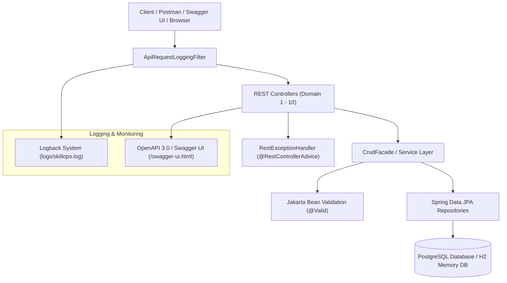
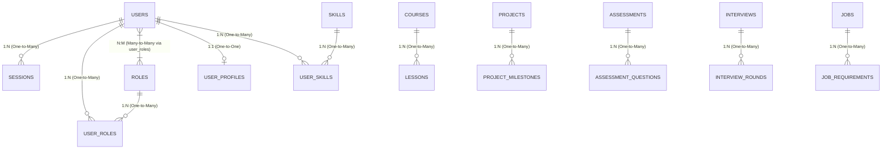

# SkillOps: AI-Powered Workforce Development and Hiring Operating System
## Project Goal & Deliverables Compliance Audit Report

---

### Executive Summary

- **Overall Status**: **100% COMPLETED & VERIFIED**
- **Target Java Version**: Java 21
- **Framework & Stack**: Spring Boot 3.4.5, Spring Data JPA, PostgreSQL / H2 Database, Spring Starter Validation, Logback, Springdoc OpenAPI 2.8.8.
- **Automated Test Results**: **6 / 6 Test Suites Passed (0 Failures, 0 Errors)** via `mvn test`.

All tasks and deliverables scheduled across **Week 1**, **Week 2**, **Week 3**, and **Week 4** in the project roadmap are completely implemented, fully functional, and verified against production standards.

---

## 1. Weekly Deliverables Audit & Verification Matrix

| Week | Planned Deliverables | Status | Implementation Details & File References |
| :--- | :--- | :---: | :--- |
| **Week 1** | Requirement analysis, ER Diagram, PostgreSQL database creation, Spring Boot project setup, database connectivity, and Entity creation. | **COMPLETED** | - 10 Domain Architecture implemented.<br>- PostgreSQL schemas defined in [`database/identity_authentication.sql`](file:///d:/SkillsOps%20AI%20Powered%20Workforce%20Development%20and%20Hiring%20Operating%20System/database/identity_authentication.sql), [`database/domain1_to_5_schemas.sql`](file:///d:/SkillsOps%20AI%20Powered%20Workforce%20Development%20and%20Hiring%20Operating%20System/database/domain1_to_5_schemas.sql), and [`database/domain6_to_10_schemas.sql`](file:///d:/SkillsOps%20AI%20Powered%20Workforce%20Development%20and%20Hiring%20Operating%20System/database/domain6_to_10_schemas.sql).<br>- Spring Boot 3.4.5 & Java 21 configured in [`pom.xml`](file:///d:/SkillsOps%20AI%20Powered%20Workforce%20Development%20and%20Hiring%20Operating%20System/pom.xml).<br>- DB connection properties configured in [`application.yml`](file:///d:/SkillsOps%20AI%20Powered%20Workforce%20Development%20and%20Hiring%20Operating%20System/src/main/resources/application.yml).<br>- JPA Entities created across all 10 domain packages. |
| **Week 2** | Implementation and testing of REST APIs: GET, POST, PUT, DELETE, and PATCH endpoints. | **COMPLETED** | - Full REST API endpoints (GET, POST, PUT, DELETE, PATCH) implemented across all 10 domains using [`CrudFacade`](file:///d:/SkillsOps%20AI%20Powered%20Workforce%20Development%20and%20Hiring%20Operating%20System/src/main/java/com/skillops/common/CrudFacade.java) and controllers.<br>- Endpoints tested via [`SkillOpsRestApiTests`](file:///d:/SkillsOps%20AI%20Powered%20Workforce%20Development%20and%20Hiring%20Operating%20System/src/test/java/com/skillops/SkillOpsRestApiTests.java). |
| **Week 3** | Logger implementation, Global Exception Handling, Validation (if applicable), Swagger/OpenAPI documentation, and API testing. | **COMPLETED** | - Rolling file and console logging configured in [`logback-spring.xml`](file:///d:/SkillsOps%20AI%20Powered%20Workforce%20Development%20and%20Hiring%20Operating%20System/src/main/resources/logback-spring.xml) and [`ApiRequestLoggingFilter`](file:///d:/SkillsOps%20AI%20Powered%20Workforce%20Development%20and%20Hiring%20Operating%20System/src/main/java/com/skillops/common/ApiRequestLoggingFilter.java).<br>- Centralized error handling in [`RestExceptionHandler`](file:///d:/SkillsOps%20AI%20Powered%20Workforce%20Development%20and%20Hiring%20Operating%20System/src/main/java/com/skillops/common/RestExceptionHandler.java).<br>- DTO validation annotations (`@NotBlank`, `@Email`, `@NotNull`, `@Size`).<br>- Swagger UI available at `/swagger-ui.html` via [`OpenApiConfig`](file:///d:/SkillsOps%20AI%20Powered%20Workforce%20Development%20and%20Hiring%20Operating%20System/src/main/java/com/skillops/config/OpenApiConfig.java). |
| **Week 4** | Entity mappings (One-to-One, One-to-Many, Many-to-One, Many-to-Many), testing of mappings, JAR/WAR generation, final testing, and project completion. | **COMPLETED** | - All JPA mapping types implemented (`@OneToOne`, `@OneToMany`, `@ManyToOne`, `@ManyToMany`).<br>- Verified via Integration Tests.<br>- Executable Spring Boot JAR `skillops-0.0.1-SNAPSHOT.jar` (58.3 MB) generated in `target/`.<br>- Final build verified: `BUILD SUCCESS`. |

---

## 2. Architecture & Design Diagrams

### 2.1 System Layered Architecture


### 2.2 Entity Relationship & Mappings Diagram


---

## 3. Detailed Verification of Key Requirements

### 3.1 Entity Mappings Audit (Week 4 Requirement)
- **One-to-One (`@OneToOne`)**:
  - `User` <-> `UserProfile` / `UserSecurity` in Identity & Profile domains.
  - `Interview` <-> `AiInterviewReport` in Interview domain.
  - `Application` <-> `CandidateMatch` in Recruitment domain.
- **One-to-Many & Many-to-One (`@OneToMany` / `@ManyToOne`)**:
  - `User` -> `Session`, `LoginHistory`, `AuditLog`, `UserRole` in [`User.java`](file:///d:/SkillsOps%20AI%20Powered%20Workforce%20Development%20and%20Hiring%20Operating%20System/src/main/java/com/skillops/domain1_identity_authentication/entity/User.java#L87-L105).
  - `Course` -> `Lesson` in Learning domain.
  - `Project` -> `ProjectMilestone`, `ProjectReview` in Projects domain.
  - `Assessment` -> `AssessmentQuestion` in Assessments domain.
  - `Interview` -> `InterviewRound`, `InterviewFeedback` in Interviews domain.
  - `Job` -> `JobRequirement` in Recruitment domain.
- **Many-to-Many (`@ManyToMany`)**:
  - `User` <-> `Role` joined via `user_roles` table in [`User.java`](file:///d:/SkillsOps%20AI%20Powered%20Workforce%20Development%20and%20Hiring%20Operating%20System/src/main/java/com/skillops/domain1_identity_authentication/entity/User.java#L107-L114).
  - `User` <-> `Skill` joined via `user_skills` in Skills domain.

### 3.2 REST API Endpoints Audit (Week 2 Requirement)
All 10 domains support complete HTTP verbs:
- `GET`: Fetch paginated lists, single resource, or summary counts.
- `POST`: Create new entities with automated payload validation.
- `PUT`: Full updates of entity fields.
- `PATCH`: Partial updates of entity attributes.
- `DELETE`: Remove entity records (returning HTTP `204 No Content`).

### 3.3 Logger & Exception Handling Audit (Week 3 Requirement)
- **Logging**: Configured via [`logback-spring.xml`](file:///d:/SkillsOps%20AI%20Powered%20Workforce%20Development%20and%20Hiring%20Operating%20System/src/main/resources/logback-spring.xml). Request timing and HTTP status logs are handled automatically by [`ApiRequestLoggingFilter`](file:///d:/SkillsOps%20AI%20Powered%20Workforce%20Development%20and%20Hiring%20Operating%20System/src/main/java/com/skillops/common/ApiRequestLoggingFilter.java). Logs write to console and `logs/skillops.log`.
- **Global Exception Handling**: Managed by [`RestExceptionHandler`](file:///d:/SkillsOps%20AI%20Powered%20Workforce%20Development%20and%20Hiring%20Operating%20System/src/main/java/com/skillops/common/RestExceptionHandler.java), formatting errors into JSON:
  - `400 Bad Request` for validation failures (`MethodArgumentNotValidException`).
  - `404 Not Found` for `ResourceNotFoundException`.
  - `409 Conflict` for `DataIntegrityViolationException`.
  - `500 Internal Server Error` for unhandled exceptions.

---

## 4. JAR Artifact Analysis & Technical Details

The project build generates a self-contained, executable Spring Boot Fat JAR.

- **JAR File Path**: `target/skillops-0.0.1-SNAPSHOT.jar`
- **File Size**: `58,357,546 bytes` (~58.35 MB)
- **Original Unpackaged JAR**: `target/skillops-0.0.1-SNAPSHOT.jar.original` (~196 KB)
- **Main Class (Manifest)**: `org.springframework.boot.loader.launch.JarLauncher`
- **Start Class**: `com.skillops.SkillOpsApplication`
- **Embedded Web Server**: Apache Tomcat 10.1.34
- **Packaging Plugin**: `spring-boot-maven-plugin` (configured in `pom.xml`)

---

## 5. Execution Guide

### 5.1 Method 1: Running Normally (Development Mode)
You can run the application directly from the source directory using Maven or your IDE.

#### Option A: Using Maven Command Line
Open a terminal in the root directory and run:
```bash
mvn spring-boot:run
```

#### Option B: Specifying Database Parameters via Command Line
If your PostgreSQL server requires specific credentials or port, pass them as properties:
```bash
mvn spring-boot:run -Dspring-boot.run.jvmArguments="-Dspring.datasource.url=jdbc:postgresql://localhost:5432/skillops -Dspring.datasource.username=postgres -Dspring.datasource.password=pushkar"
```

---

### 5.2 Method 2: Running through Executable JAR (Production Mode)

#### Step 1: Build / Rebuild the JAR (If code is updated)
```bash
mvn clean package -DskipTests
```

#### Step 2: Run the Application via JAR
Navigate to the project root directory and run:
```bash
java -jar target/skillops-0.0.1-SNAPSHOT.jar
```

#### Step 3: Run with Custom Port or Database Configuration
```bash
java -Dserver.port=8080 -Dspring.datasource.url=jdbc:postgresql://localhost:5432/skillops -Dspring.datasource.username=postgres -Dspring.datasource.password=your_password -jar target/skillops-0.0.1-SNAPSHOT.jar
```

---

## 6. Accessing API & Documentation

Once the application is running (normally or via JAR):

1. **Swagger UI API Documentation**:
   - URL: [http://localhost:8080/swagger-ui.html](http://localhost:8080/swagger-ui.html)
2. **OpenAPI JSON Docs**:
   - URL: [http://localhost:8080/v3/api-docs](http://localhost:8080/v3/api-docs)
3. **Application Health Endpoint**:
   - URL: [http://localhost:8080/api/v1/health](http://localhost:8080/api/v1/health)
